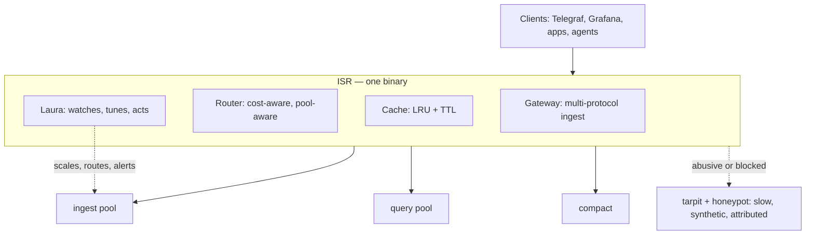
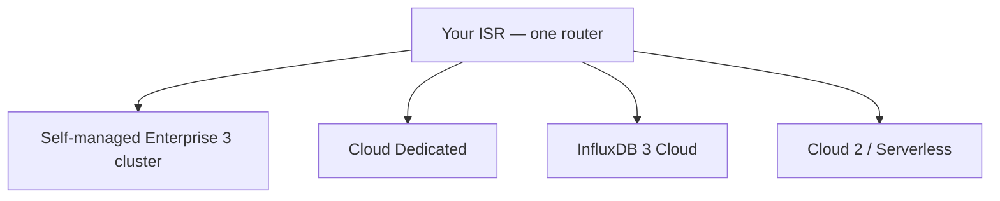
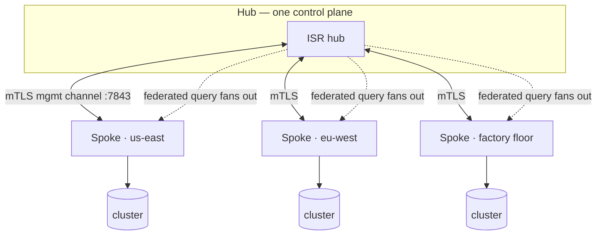
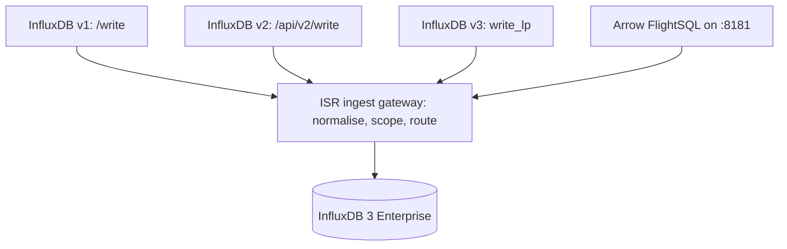
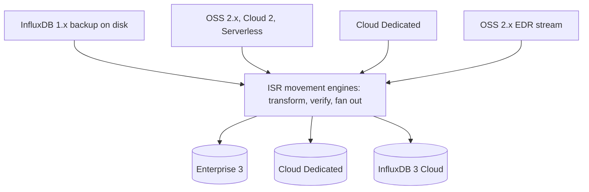
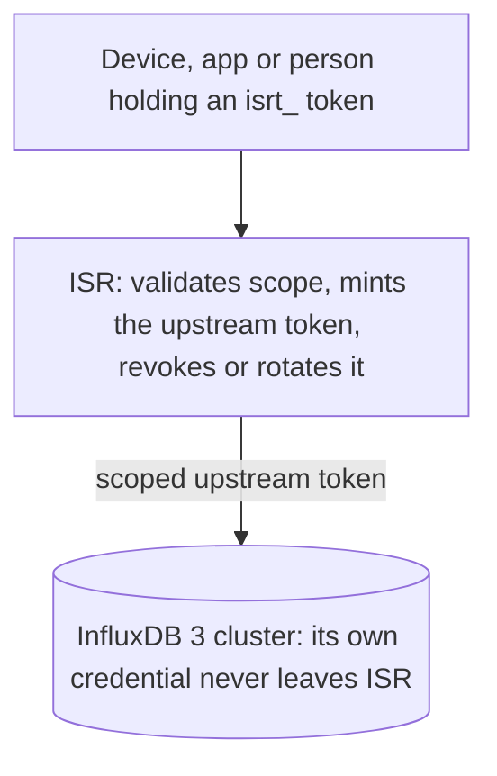
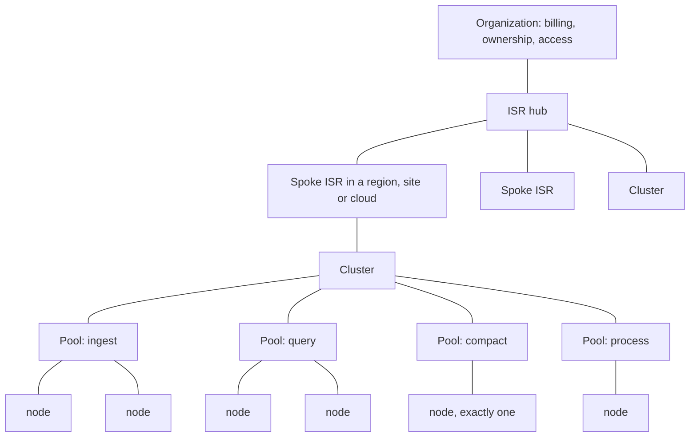

# ISR — the InfluxDB Smart Router

**Put an operations layer in front of InfluxDB 3 Enterprise, in about five minutes.**

ISR is a single binary that sits in front of your InfluxDB 3 Enterprise cluster
and turns it into something an operator can actually run: it routes and caches
queries, scales nodes against your licence, quarantines abusive traffic, moves
data in and out of anywhere, and explains every decision it makes in words.

---

## 1. What is ISR, and why does it feel like cheating?

InfluxDB 3 Enterprise is a superb storage engine, and it is deliberately
focused on being one: ingest, compaction, query, and the object-store
durability underneath them. ISR is the operations layer that sits in front of
it. It adds the things an operator reaches for every day — query guardrails, an
autoscaler, a multi-protocol front door, a fleet view, a migration engine, and
tokens scoped as narrowly as one database for one contractor — without changing
the engine itself.

**ISR is that layer, and it is one container.**



**Time to awesome, measured honestly:**

| Minute | What you have |
| :-- | :-- |
| 0 | `sh install-mac.sh` (or `install-linux.sh`) |
| 2 | Console open, cluster adopted, first database created |
| 5 | Writes flowing through the gateway, queries cached, dashboards live |
| 10 | An autoscaler watching load, a bad-query policy armed, alerts wired to Slack |

### What ISR adds in front of Enterprise 3

- **A query cost engine.** ISR runs `EXPLAIN` *before* a query executes, scores
  it, and can slow it, divert it to an isolated pool, or kill it — so one
  runaway `SELECT *` never becomes everybody else's latency.
- **Tokens that mean something.** Scope a token to a database, a table, a tag,
  an action — and rotate or revoke it without touching the cluster. See §8; this
  is the section people underestimate and then can't live without.
- **A trap for whoever is probing you.** Block a bad actor and they don't get an
  error — they get a *tarpit*. Their requests are answered slowly, by a synthetic
  endpoint that impersonates a real InfluxDB right down to the version string,
  serving plausible fake data while a max-dwell timer decides how long to keep
  them there. Your actual cluster never sees the request. A scanner that would
  have found a 403 in milliseconds and moved on instead burns minutes on data
  that was never real, and every second of it is attributed and counted.

  **The decoy is a dead end by construction — there is nowhere to hop to.** The
  synthetic data lives entirely inside the honeypot: a separate InfluxDB *Core*
  node (a different binary from your Enterprise cluster), on the **default bridge
  rather than the cluster network**, backed by a **memory store** with no
  object-store credentials and no admin token. It cannot reach your nodes, it
  holds nothing of yours, and it persists nothing — an attacker who fully owned
  it would have won a container with fabricated data in it and no route onward.

  Blocking is one control across IP, user, token and agent — enforced at the
  proxy *and* at login, so there is no second door.
- **An autoscaler that respects your licence.** It knows your licensed core
  count and scales vertically, then horizontally, then throttles — rather than
  cheerfully provisioning capacity you are not entitled to run.
- **A migration engine that reads backups directly.** Point it at an InfluxDB
  1.x backup on disk and it streams straight into InfluxDB 3 — no old cluster to
  resurrect. See §7.
- **A fleet.** One hub, many spokes, across regions and clouds, with federated
  queries that fan out and come back as one answer. See §5.
- **Laura.** An operator-grade intelligence that watches the cluster, proposes
  tuning with its reasoning attached, and — when you hand her the wheel — acts on
  it. Every action she takes is logged *and* alerted.

> **Everything is explained.** Every routing decision, scaling action and
> rejected query carries the reasoning that produced it. ISR is built on the rule
> that an operator should never have to guess why something happened.

---

## 2. Get started in five minutes

### The one-liner (recommended)

```bash
# macOS (Docker Desktop)
curl -fsSL https://raw.githubusercontent.com/M617263Kaplan/influxdb-smart-router/main/install-mac.sh | sh
# Debian / Ubuntu
curl -fsSL https://raw.githubusercontent.com/M617263Kaplan/influxdb-smart-router/main/install-linux.sh | sh
```

On Windows, run `install-windows.ps1` from PowerShell with Docker Desktop
running, or use the Linux line inside WSL2 (see the note below).

It detects your architecture, pulls the matching release image, verifies the
checksum, loads it, and starts the hub. When it finishes it **opens the console
in your default browser** — you land on Getting Started without copying a URL.

It opens the browser only once the console has actually answered, so you never
get a connection error that looks like a failed install. It won't try over SSH,
on a host with no display, or if you set `NO_BROWSER=1` (`BROWSER=none` works
too) — in each of those cases it prints the URL and says which one applied.

> **Windows: use WSL2. Git Bash / MSYS / Cygwin are not supported yet.**
>
> The installer refuses on those shells rather than half-installing. They rewrite
> POSIX-looking paths, which breaks the Docker socket mount ISR needs to launch
> InfluxDB nodes: ISR would start, report **healthy**, and be unable to create a
> single node — with nothing in the error naming the cause.
>
> WSL2 is the supported path on Windows and needs no extra setup if you use
> Docker Desktop's default WSL2 backend:
>
> 1. PowerShell: `wsl --install` (once, then reboot)
> 2. Docker Desktop → **Settings → General** → *Use the WSL 2 based engine*;
>    **Settings → Resources → WSL integration** → enable your distro
> 3. Open your WSL terminal and run the installer there
>
> `ISR_ALLOW_WINDOWS_SHELL=1` forces an attempt on those shells; it is unsupported.

### Docker, by hand

```bash
docker run -d --name isr \
  -p 9800:9800 -p 8086:8086 -p 8181:8181 \
  -v /var/run/docker.sock:/var/run/docker.sock \
  -v isr-state:/var/lib/isr \
  isr:v<version>-arm64     # or -amd64
```

The Docker socket is how ISR launches and scales your InfluxDB nodes. Prefer a
least-privilege socket proxy? ISR supports it.

### AWS · GCP · Azure

ISR deploys its own spokes into your cloud accounts:

1. Add a **cloud account** in the console — a *credential reference*, not a
   pasted key. AWS SSO, GCP and Azure are supported.
2. **Fleet → Create a spoke.** ISR stages its own image to your object store and
   emits a Terraform/OpenTofu module.
3. The spoke enrols over the hardened management channel and appears in your
   fleet.

From then on the hub is the fleet's image store: upgrade the hub, then push to
spokes over the management channel. No registry, no manual SSH.

### Connecting Grafana & InfluxDB 3 Explorer

Point dashboards at **ISR** instead of a node: every query then flows through ISR — token policy, badness scoring, caching, and routing (including transparent routing to adopted Influx Cloud databases) all apply, and each tool shows up on **Monitor → Client Apps** (connectivity, activity, and a request log — no client-side agent).

Both tools authenticate with an **ISR client token** (`isrt_…`) — mint one under **Tokens** scoped to the database(s) the dashboards read, or use the paired token created when adopting an Influx Cloud instance. Clients never hold node or cloud credentials; ISR injects the real upstream credential per request, and revoking the `isrt_` token cuts access instantly.

**Grafana — InfluxDB data source (SQL, recommended):**

```text
Connections → Data sources → Add data source → InfluxDB
  Query language:  SQL
  URL:             http://<isr-host>:8181
  Database:        <your database>            (e.g. isr)
  Token:           <isrt_… ISR client token>
```

**Grafana — InfluxQL (v1-style dashboards):**

```text
Connections → Data sources → Add data source → InfluxDB
  Query language:  InfluxQL
  URL:             http://<isr-host>:8086
  Custom HTTP Header:  Authorization: Token <isrt_… token>
  Database:        <your database>
```

**InfluxDB 3 Explorer** — from 3.11, Explorer is served by a `--mode webui` node (a data node doesn't serve it); ISR launches a dedicated one for you, or gives you the connect values to point the standalone Explorer at ISR:

```text
Add server / connection:
  Server URL:  http://<isr-host>:8181
  Token:       <isrt_… ISR client token>
  Database:    <your database>
```

Save & test, then open **Monitor → Client Apps** — the Grafana / Explorer card flips to **connected** on the first query, with per-database activity and a filterable request log. (`:8181` serves the InfluxDB 3 API + FlightSQL used by Grafana's SQL mode and Explorer; `:8086` serves InfluxQL / v1–v2 clients. Matching setup steps live in the in-console **Docs → Connect Grafana & InfluxDB Explorer**.)

---

## 3. Every tab, and why it exists

ISR's console is organised into workspaces. Sections 4–9 cover the deep ones;
this is everything else.

This layout is a *starting point*, not a fixture: each operator
pins, hides and reorders their own, saved to their account rather than the
browser. Hiding never removes access — a hidden page stays in search, in ⌘K, and
on its own link. See [docs/personal-navigation.md](docs/personal-navigation.md).

### Monitor
| Tab | Use case | Why it matters |
| :-- | :-- | :-- |
| **Summary** | The single screen you leave open | Cluster health, throughput, and what changed — at a glance |
| **Databases** | Per-database storage, writes, reads, retention | Create a database *with* retention before the first write, so you never inherit a schema you didn't choose |
| **Data Flow — Command Center** | A live hierarchical map of every component and the traffic between them | When something is slow, you see *where* rather than inferring it |
| **Dashboards** | Per-database confirmation dashboards | Proves data is actually landing, then dismisses itself |

### Cluster & Capacity
| Tab | Use case | Why it matters |
| :-- | :-- | :-- |
| **Cluster Nodes** | Node inventory, modes, cores, live load | One compactor per cluster is enforced here — the invariant that silently corrupts a cluster if broken |
| **Autoscaling** | Vertical → horizontal → throttle, against your licence | Capacity that responds to load without exceeding what you're licensed for |
| **ISR Resource Capacity** | ISR's own CPU/memory headroom | The control plane is a component too; it should not be the surprise bottleneck |
| **Versions** | Which InfluxDB builds exist, what your nodes run, rolling upgrades | Upgrade one node at a time, compactor last, with rollback |

### Traffic & Routing
| Tab | Use case | Why it matters |
| :-- | :-- | :-- |
| **Routing rules & pools** | Send traffic to the right pool by database, region, token, agent or cost | The cornerstone: good traffic gets the fast path, expensive traffic gets isolated |
| **Query Cache** | LRU + TTL in front of the query pool | Repeated dashboard queries stop reaching the cluster at all |
| **Durable Write Queue** | Accept-and-replay when the cluster is unreachable | A write is acknowledged and parked on disk, then replayed — an ingest outage costs latency, not data |
| **Load Balancing** | Latency-aware upstream selection | The healthy, nearest node serves the request |
| **Governance** | Header and policy rules over live traffic | Change behaviour without a restart |

### Security
| Tab | Use case | Why it matters |
| :-- | :-- | :-- |
| **Tokens & enforcement** | Issue scoped tokens; enforce at the gateway | See §8 — this replaces cluster-wide credentials |
| **Access Control / Roles** | admin · operator · viewer, with an access review | Answer "who can do what?" without reading config |
| **Two-factor & password policy** | TOTP enrolment, reset by email | The console is an admin surface; treat it like one |
| **Blocklist** | Block an IP, user, token or agent at the proxy *and* login | One control that actually stops a bad actor everywhere |
| **Tarpit & honeypot** | Abusive traffic gets slow, synthetic answers | Attackers burn time on fake data instead of your cluster — and the decoy is contained: a Core node on a separate network with a memory store and no credentials, so there is nothing to pivot to |

### Audit & Compliance
| Tab | Use case | Why it matters |
| :-- | :-- | :-- |
| **Query Audit & Bad-Query Journal** | Every expensive query, with its plan and cost | The evidence for "which query is hurting us?" |
| **Query-Log Retention** | Keep classes of query logs for different periods | Compliance without unbounded storage |
| **Usage-Based Isolation** | Give a noisy tenant their own dedicated pool | One tenant stops being everyone's problem |
| **Compliance** | PII redaction and data-residency enforcement | Rules enforced in the data path, not in a document |

### Intelligence
| Tab | Use case | Why it matters |
| :-- | :-- | :-- |
| **Laura** | Ask the cluster questions in plain language | An operator-grade assistant that reads real state, never guesses |
| **Learning Engine** | Proposals with confidence and reasoning; optional autonomy | Approve a change, or hand Laura the wheel — per instance, never fleet-wide |
| **Pipeline Optimization** | Doc-grounded schema/write/query recommendations | Scored by impact, linked to the official guidance |
| **Compaction KB** | What every compactor metric means and which flag helps | Turns compactor telemetry into an action |

### Operations
| Tab | Use case | Why it matters |
| :-- | :-- | :-- |
| **Engine log & fleet-wide logging** | One durable journal across hub and spokes | Read an incident in time order across the whole fleet |
| **Alerts & Notifications** | Slack · email · PagerDuty · incident.io | Alerts carry reasoning *and* remediation, not just a red dot |
| **Backup & Restore** | Config snapshots, authenticated download | Secrets are omitted and tokens redacted by design |
| **Release scrub** | Synthetic writes *and* reads, with variance vs the previous release | A release that is correct but 3× slower is caught before it ships |
| **Telemetry export** | Push ISR's own metrics to any InfluxDB | ISR monitors itself with your existing tooling |
| **Reporting to the maintainers** | A daily, fixed, coarse report that this deployment exists | Every field is listed in [TELEMETRY.md](TELEMETRY.md); one switch turns it off |

---

## 4. Adopting InfluxDB 3 Cloud and Cloud Dedicated

One control plane over managed **and** self-managed InfluxDB.

Add a hosted instance as a first-class upstream and ISR treats it like any other
destination — routable, queryable, and a valid target for migration, replication
and Cloud Copy.



- **Adopt** an instance with its management API and token; ISR discovers its
  databases and health.
- **Cloud Copy** moves data instance-to-instance without a local hop.
- **Federated query** (§5) spans adopted instances and your own clusters in one
  answer.

> A hostname is not a reliable way to tell these products apart — ISR asks the
> API rather than pattern-matching a URL, because the naming genuinely overlaps.

### Reference — adopted-instance detail

ISR can **adopt a hosted InfluxDB 3 Cloud instance** (InfluxDB Cloud Dedicated / Enterprise Cloud) as a first-class, routable member of the fleet — alongside the self-managed clusters it already fronts. A managed cloud database stops being an island: ISR can **discover it, query it, migrate into it, and replicate to it (EDR)**, each using that instance's own token. This is the foundation for **multi-cluster** operation, **mirrored regions across cloud providers**, and unified migration / backfill / EDR pipelines from the edge and on-prem into the cloud.

### How it works

- **Adopt an instance.** A hosted instance is registered as a single routable upstream tagged with its **cloud provider** (AWS / Azure / GCP) and **region**. ISR never scales or upgrades it — the provider owns its lifecycle — so it's modeled as an opaque endpoint, not a scalable node pool.
- **Two credentials, cleanly separated.** A **management token** (`M.V1.…`) is used only to *discover* the account's instances and poll status via the Cloud-Dedicated management API (`console.influxdata.com/api/v1`); it cannot read or write data. A **data token** (per database, from `influxdb3 create token` / `influxctl token create`) is stored **write-only** and is what makes the instance routable.
- **Every data-plane operation uses the instance's own token.** Internally ISR resolves each adopted instance to `(url, data-token)` and talks straight to its data plane — `POST /api/v3/query_sql` for reads, `POST /api/v3/write_lp` for writes — with that instance's Bearer token. No shared/global credential is used, so many instances (many providers, regions, and databases) coexist with independent access.
- **Two ways to onboard.** *Set up with Google (OAuth)* now works for **both** cluster types: for **Cloud Dedicated** ISR drives **`influxctl`** (the management-plane CLI, bundled in the image) over the Google/SSO device-code login to **list your databases, create one with retention, and mint a scoped `apiv3_…` data token** — the operations Dedicated exposes on its management plane; for self-managed / unified Cloud it drives the `influxdb3` CLI instead. ISR can also **pair an ISR client token** scoped to the new database in the same step. Or *paste a token* you minted yourself with the console / `influxctl` — still fully supported.

### What you can do today

- **Discover & adopt** every instance in a Cloud-Dedicated account from one management token — provider, region, URL, and status auto-filled. Discovery queries **both generations** of the management API (`/accounts/{id}/instances` *and* `/accounts/{id}/clusters`, merged and deduped — some Dedicated clusters appear only under the older endpoint), and the data-token check is Dedicated-aware: when the v3 configure API isn't exposed (404), supply a database name and ISR verifies the `apiv1_…` token via the v1 query API instead.
- **Query & observe** an adopted instance directly from **Monitor → Cloud Buckets**: measurements, row counts, ingest-rate charts, and recent points, pulled live with the instance's token.
- **Migrate** from OSS / self-managed InfluxDB into a chosen cloud database — the Migration workflow lists adopted cloud instances as targets and streams line protocol into them (points beyond the target's retention window are dropped as expected).
- **EDR (Edge Data Replication)** from an OSS 2.x edge, through ISR, into a **cloud database you pick** — ISR receives on `/api/v2/write`, optionally coerces field types for PachaTree, and forwards to the instance's data plane with its token.
- **Route live client traffic transparently.** A database mapped to an adopted instance is served by that instance on the hot path — ISR injects the instance's own data token per request (clients hold only an ISR token via *Pair ISR token*), the divert obeys ISR's auth/badness/compliance gates, works even with zero self-managed nodes, and every transfer lands in the Influx Cloud traffic ledger.
- **Choose the destination database** per pipeline: one instance can hold, e.g., a `migration` bucket and a separate `edr` bucket, each with its own scoped token.

### Why it matters

- **Adopt managed cloud without giving up control.** Keep ISR's routing, schema governance, token policy, and observability while the heavy lifting runs on InfluxData-managed infrastructure.
- **Bridge on-prem, edge, and cloud** in one fleet — migrate and replicate across the boundary instead of running parallel stacks.
- **Cross-provider / cross-region resilience and residency** — mirror or steer data by provider and region on your terms, not a single cloud's.
- **No new control plane to learn** — the same ISR console, API, and governance you already run now reach into managed cloud.

See **[Cloud Instances](#cloud-instances-adopt-hosted-influxdb-3)** below for the step-by-step.

---

## 5. Fleet: HA, multi-region replication, federated queries, edge autonomy



**High availability.** Leader election over a Postgres advisory lock, with VRRP
VIP failover — proven live with reads and writes continuing through the
failover. An embedded-Raft backend exists as an opt-in alternative with no
external database.

**Multi-region replication.** Mirror databases edge→hub over mutual TLS, with
**confirm-before-clear**: a write is never dropped from the local buffer until
the destination acknowledges it. Per-target cursors mean one unreachable
destination cannot stall the others.

**Fan-out federated query.** Ask one question, get one answer, from clusters in
several regions and clouds — including adopted Cloud instances. Any instance ISR
could not reach is *named*, rather than a partial fleet being presented as the
whole one.

**Edge autonomy.** When the link drops, an edge ISR keeps accepting writes into
a durable, disk-backed queue and replays them when connectivity returns. The
guarantee is explicit: **writes are never lost during a disconnection.**

**Data residency.** A batch containing points from several regions is split
per-line and each line is sent to its own region's spoke — and it fails safe
rather than sending data somewhere it must not go.

---

## 6. The multi-protocol ingest gateway

Most fleets do not speak one protocol. ISR accepts several and normalises them
into InfluxDB 3 writes.



- **Speak v1 or v2 to a v3 cluster.** Existing Telegraf agents, client libraries
  and scripts keep working while the storage layer moves underneath them.
- **FlightSQL is terminated, not tunnelled.** ISR decodes the SQL, so query
  scope, cost scoring and routing apply to Arrow clients exactly as they do to
  HTTP.
- **mTLS ingest** is available on its own listener for certificate-authenticated
  writes.
- Every accepted write is subject to the same token scope, schema enforcement
  and routing rules as any other.

---

## 7. Getting data in: migration, EDR, replication, backfill



**Migrate from a backup file — no source cluster required.** Point ISR at an
`influxd-ctl backup` or `influxd backup -portable` archive. It reads the manifest
*and* the meta snapshot (the only record of *when* the data is), unpacks shards
in parallel, streams each through `influx_inspect` into line protocol,
transforms, and fans out to every destination. Nothing intermediate lands on
disk: peak memory is one batch whether the backup is 66 MB or 66 TB.

**Readiness first.** A dry run assesses the source schema and reports everything
that would block or corrupt the run — tag/field collisions, field-type conflicts,
column-count breaches — each with a remediation you choose. Then it previews the
fixes against real sample data before a byte moves.

**Per-destination batch sizing.** A fan-out sends to several clouds at once, and
they do not have the same limits — InfluxDB 3 Cloud rejects 11.2 MB where Cloud
Dedicated takes it happily. Each destination carries its own ceiling and
*discovers* it: a payload-too-large answer halves only the destination that sent
it and re-sends the same rows, so a strict endpoint never taxes its peers and no
shard fails over a sizing choice.

**Replication.** Continuous mirroring with two shapes: a **write-time tee**
(latency is one network round-trip) and a **polling runner** (windowed,
downsampled, scheduled). Both carry row deletes, so a replica cannot silently
keep rows the source removed.

**EDR receiver.** ISR stands in as the Edge Data Replication remote for an
InfluxDB OSS 2.x edge and lands the stream in Enterprise 3 — proven end-to-end
from OSS 2 through ISR into Enterprise.

**Backfill and Cloud Copy.** Move a historical window between any two adopted
instances, with per-table verification against the *expected* post-transform
values rather than a naive source-equals-target count.

---

## 8. Tokens: the part people underestimate

**ISR tokens replace InfluxDB cluster tokens. This is the single highest-leverage
design decision in the product.**

An InfluxDB cluster token is close to all-or-nothing and belongs to the cluster.
Hand one to a contractor, a Grafana instance or a device and you have handed over
far more than you meant to — and taking it back means rotating a credential the
whole cluster depends on.

ISR inverts it:



**What an `isrt_` token can be scoped to:**

| Scope | Example |
| :-- | :-- |
| Databases | this token sees `telemetry` and nothing else |
| Actions | read-only, write-only, or both |
| Tables | only the `cpu` measurement |
| Tags | only rows where `region = us-east` |
| Query protocols | HTTP only, or FlightSQL too |

**Why this is powerful:**

- **The cluster credential never leaves ISR.** Clients hold an ISR token; ISR
  mints the scoped upstream token. Nobody downstream ever sees the cluster's own
  credential.
- **Revocation is instant and local.** Kill one token at the gateway. The
  cluster is untouched and nothing else is disturbed.
- **Scope InfluxDB cannot express natively** — per-table and per-tag — is
  enforced in the data path, on every protocol, including FlightSQL.
- **Tokens are stored fingerprinted, never in the clear.** A config export
  redacts token values and omits secret material entirely.
- **Every use is attributable.** Audit, cost and bad-query journals are keyed by
  token, so "who ran that?" has an answer.
- **Enforcement is a switch.** Run permissively while you migrate clients, then
  turn enforcement on — no restart.

---

## 9. How it all fits together



**Read it top down:**

- **Organization** — who owns and pays for this. Billing and access attribution
  hang here.
- **ISR hub** — one control plane. It is also the fleet's image store.
- **Spoke** — another ISR, in another region, site or cloud, enrolled to the hub
  over a hardened mTLS management channel. A spoke keeps running if the hub
  disappears.
- **Cluster** — an InfluxDB 3 Enterprise cluster. **A cluster is multi-node by
  definition**, and needs at least one node of *every* mode.
- **Pool** — a named group of nodes of one mode. Pools are what routing targets
  and what the autoscaler grows and shrinks.
- **Node** — one InfluxDB 3 process, in exactly one mode.

**Two rules worth knowing before you design a topology:**

1. **Exactly one compactor per cluster.** There is no leader election between
   compactors; a second one is undefined behaviour. ISR enforces this.
2. **A single node is an SNE (Single Node Enterprise), not a cluster.** It runs
   `--mode all` and carries its own compactor. Growing it into a cluster means
   standing up ingest, query and process pools *first*, then converting the
   original node to the compactor — not adding a node beside it.

---

## Ready?

```bash
curl -fsSL https://raw.githubusercontent.com/M617263Kaplan/influxdb-smart-router/main/install-mac.sh | sh
```

Then open the printed URL, and let Getting Started walk you the rest of the way.

Everything below is reference material: upgrade procedures, the console
workspaces in depth, the admin API, and per-feature configuration.

---

## Upgrading

Config (admins, tokens, policies, pools, runtime flags) lives in an embedded
SQLite database in the `isr-state` volume — **not** in the
container itself — so upgrading is swapping the container while keeping that
volume, not a data migration:

```bash
# 1. Optional but recommended: snapshot current config first (Admin & Docs →
#    Backup and Restore → Create Backup → Download Latest Backup). This is a
#    JSON export for disaster-recovery reference; passwords/tokens are never
#    included (see the Restore section below) so it's safe to keep around.

# 2. Pull + load the new release image (same steps as Deploying ISR above,
#    new version tag), then swap the container onto the SAME state volume:
docker rm -f isr
docker run -d --name isr \
  --restart unless-stopped \
  -p 9800:9800 -p 8086:8086 -p 8181:8181 \
  -v /var/run/docker.sock:/var/run/docker.sock \
  -v isr-state:/var/lib/isr \
  -e ISR_LISTEN=0.0.0.0:9800 \
  -e ISR_DATA_LISTEN=0.0.0.0:8086,0.0.0.0:8181 \
  -e ISR_STATE_DB=/var/lib/isr/state.db \
  isr:v<new-version>-arm64   # or -amd64

# 3. Verify: console loads, admins/tokens/pools are all still there, and
#    `docker logs isr` shows no SQLite errors on startup.
```

InfluxDB node containers and their data are untouched by this — only the
`isr` control-plane container is recreated. Schema changes to the embedded
SQLite state are additive, so an in-place upgrade doesn't lose or corrupt
existing config.

**Rolling back:** keep the previous version's image loaded (`docker images`)
and re-run the same `docker run` with the old tag against the same volume —
config an older binary doesn't understand is simply ignored, not deleted.
**Recreating on another host:** download a backup (above) and use *Restore
from a downloaded snapshot* on the new instance to bring back runtime
flags/routing rules and organizations; you'll need to recreate admin logins
and re-mint tokens there, since those secrets are deliberately never in the
backup.

## Getting Started (console wizard)

On first run the console opens a **Getting Started** wizard that walks from
nothing to a live, licensed InfluxDB 3 Enterprise cluster: administrator →
operator → organization → cluster & license → topology/pools & object store →
bad-query management → security tarpit → database → autoscaling → optional
migration → summary. Every step tolerates being re-run.

**Reopening the wizard** (the 🚀 button, or *Getting Started → Open the
wizard*) always starts by asking **where you want to work** — this hub, an
existing spoke, or a spoke you deploy on the spot — then probes that target
for what already exists and resumes on the right step instead of restarting
at Organization. The same logic drives *Fleet → Create cluster on this spoke*.

**Deploying a cloud spoke never dead-ends.** Fleet's *Deploy a spoke* card
(local Docker or AWS, with region + instance-size pickers and an ISR-owned AWS
SSO sign-in flow) drops you back into the wizard, targeted at the spoke that
just came up, via a *Continue Getting Started on this spoke →* button on the
deploy success card.

**Cloud object store.** Cloud spokes are handed AWS access to their own
object-store bucket via an EC2 **IAM instance profile**, scoped to buckets
named `isr-*`. The wizard's object-store step defaults to **S3** — not local
MinIO — whenever the target is a cloud spoke, with the bucket/region
pre-filled and no credential fields required.

## Fleet (hub-spoke)

The **Fleet** workspace manages spokes — other ISR instances this
hub controls via command forwarding (upgrading to a hardened, dedicated mTLS
management channel once enrolled):

- **Create a spoke** — deploy a new spoke (local Docker or AWS)
- **Register a spoke** — attach an existing, already-running ISR
- **Cluster** — pick a spoke and jump into Getting Started, targeted at it
- **Status** — every spoke plus its cluster's live node count/health
- **Metrics** — per-spoke (or all-spokes) live metrics, filterable by a dropdown
- **IP & channel** — hardened mTLS channel enrollment, allowlists, pinned certs
- **Backups**, **Alerts** — per-spoke, aggregated over the same forwarding path

The top-bar cluster-context dropdown lists every registered spoke — even
before it has a cluster — as a navigation shortcut into Fleet → Metrics.

## Cloud Instances (adopt hosted InfluxDB 3)

**Cluster & Capacity → Cloud Instances** adopts **externally-managed hosted
InfluxDB 3** instances (InfluxDB Cloud Dedicated / Enterprise Cloud,
`*.enterprise.influxdb.io`). ISR handles **routing, migration, backfill,
replication, EDR, and schema tracking** for them — the **provider owns their
lifecycle**, so ISR never scales or upgrades a hosted instance. Each is
registered as a single routable upstream tagged with its **cloud provider and
region**; register several (or ones you launch later) and ISR load-balances /
fails over across them.

A hosted instance uses **two credentials**:

- **Management token** (`M.V1.…`) — optional; lets ISR *discover* your account's
  instances (prefilling provider / region / URL) and poll their status. It
  **cannot read or write data**.
- **Data token** — required for routing / replication / EDR. Mint it with the
  `influxdb3` CLI and paste it in (stored write-only, masked at rest):

  ```bash
  influxdb3 auth login --oauth                        # Google SSO, once
  export INFLUXDB3_HOST_URL=https://<instance>.enterprise.influxdb.io
  influxdb3 create token --admin --name "isr"         # full access
  # — or least privilege, scoped to one database:
  influxdb3 create token --permission "db:mydb:read,write" --name "isr"
  ```

**One-click OAuth setup (no CLI, no token pasting).** Instead of pasting a token,
click **Connect with Google & provision**. ISR runs `influxdb3 auth login --oauth`
for the instance in a throwaway container from the InfluxDB image it already
manages (via the Docker socket — nothing bundled), shows you the **Auth0
verification URL + one-time code**, and waits while you approve in your browser
with Google. On approval, ISR **creates the database** and **mints the data
token** for you (optionally an admin token for future management), stores them
write-only, and marks the instance routable — automatically. Falls back to manual
paste when the Docker socket / InfluxDB image aren't available.

Pick a **cloud provider** (AWS / Azure / GCP) and its **region**, paste the
instance URL and data token, **Test connection**, then **Adopt**. Per-instance
toggles select which subsystems may target it (routing / migration / replication
/ EDR / schema).

| Method | Path | Purpose |
| --- | --- | --- |
| `GET` | `/api/isr/cloud/instances/providers` | provider + region catalog |
| `POST` | `/api/isr/cloud/instances/discover` | management-token discovery (never persisted) |
| `POST` | `/api/isr/cloud/instances/probe` | data-token reachability + database list |
| `GET` / `POST` | `/api/isr/cloud/instances` | list (secrets masked) / adopt |
| `DELETE` | `/api/isr/cloud/instances/:id` | forget an instance |

## Advanced: deployment automation API

The `local-docker` deployment target can launch additional local ISR
replicas through the leader-gated deployment apply API.

```bash
# Safe dry-run
curl -X POST http://<host>:9800/_admin/api/deployment/apply \
  -H 'content-type: application/json' \
  --data '{"target":"local-docker","dry_run":true}'

# Real apply
curl -X POST http://<host>:9800/_admin/api/deployment/apply \
  -H 'content-type: application/json' \
  --data '{"target":"local-docker","dry_run":false}'
```

Launched replicas can override bootstrap identity and HA settings with
environment variables: `ISR_LISTEN`, `ISR_INSTANCE_ID`, `ISR_REGION`,
`ISR_STATE_DSN`, `ISR_HA_ENABLED`, `ISR_LEADER_LOCK_KEY`,
`ISR_LEADER_TICK_SECONDS`.

## Admin API reference

- `GET /_admin/api/config` redacted runtime config
- `GET /_admin/api/balancer` load-balancer and upstream health
- `POST /_admin/api/balancer/upstream` enable or drain an upstream
- `GET /_admin/api/influxdb/nodes` InfluxDB node orchestration state
- `POST /_admin/api/influxdb/node` enable or drain an InfluxDB node
- `GET /_admin/api/cache` cache status
- `POST /_admin/api/cache/toggle` enable or disable cache
- `POST /_admin/api/cache/purge` purge cache entries
- `GET /_admin/api/rate-limit` limiter buckets and route policies
- `GET /_admin/api/retry-budget` retry budget buckets and route policies
- `GET /_admin/api/governance` governance rules
- `GET /_admin/api/schema-governance` InfluxDB measurement governance
- `GET /_admin/api/flightsql` FlightSQL/gRPC routes and query-control policy
- `GET /_admin/api/honeypot` honeypot/tarpit policy
- `GET /_admin/api/replication` replication peers and jobs
- `POST /_admin/api/auth/scope-test` ISR-style token scope explainer
- `POST /_admin/api/replication/push` leader-gated snapshot push to a peer
- `POST /_admin/api/replication/receive` replication snapshot receiver
- `POST /_admin/api/replication/identity-sync` ISR-compatible identity payload receiver
- `GET /_admin/api/token-governance` redacted token policies
- `GET /_admin/api/usage` billing and capacity counters
- `GET /_admin/api/write-queue` durable write queue status (depth, bytes, capacity, drops)
- `GET /_admin/api/write-queue/entries` redacted pending writes
- `GET|PUT /api/isr/config/sink-reaper` operator control of the bad/regex sink-pool idle reaper — drains + scales dedicated bad-traffic pools to zero once their diverted traffic stops (`idle_seconds`, default 180; `enabled`)
- `GET /api/isr/router/decisions` carries a per-request `badness` score (0-10) plus `badness_reasons` — the human-readable explanation the console renders in its "why is this bad" detail
- `GET|PUT /api/isr/config/write-queue` operator-set queue capacity — how much data ISR may hold (durably, on the state volume) while ingest nodes are down or overloaded (`max_entries` / `max_bytes`, 0 = unlimited)
- `GET /_admin/api/ha` HA role and advisory lock settings
- `GET /_admin/api/deployment` deployment target model
- `GET /_admin/api/deployment/artifacts` generated deployment artifacts
- `POST /_admin/api/deployment/materialize` write generated artifacts into a local relative bundle directory
- `GET /_admin/api/deployment/runtime` observed deployment runtime state
- `GET /_admin/api/deployment/preflight` Docker, Kubernetes, and Terraform launcher checks
- `POST /_admin/api/deployment/plan` build a launch plan
- `POST /_admin/api/deployment/apply` leader-gated dry-run/apply path
- `POST /_admin/api/deployment/destroy` leader-gated dry-run/teardown path
- `GET /_admin/api/scaling/state` scaler status
- `GET /_admin/api/scaling/nodes` managed node inventory
- `GET /_admin/api/scaling/events` scaling action history
- `POST /_admin/api/scaling/scale-up` leader-gated scale-up planner
- `POST /_admin/api/scaling/scale-down` leader-gated scale-down planner
- `GET /_admin/api/performance` throughput target profile
- `GET /_admin/api/dry-run` structured runtime validation
- `GET /_admin/api/events` audit stream
- `GET /_admin/api/backup` redacted runtime snapshot
- `GET /metrics` Prometheus exposition

## Migrating from an InfluxDB 1.x backup

ISR reads an InfluxDB 1.x *portable* backup off disk and writes it into one or
more InfluxDB 3 destinations, resumably, without restarting the old server.
Shards move in parallel, bounded by a scratch-space budget rather than by worker
count — which is what actually governs throughput, and the usual reason a tuned
run is slow.

See **[docs/backup-file-migration.md](docs/backup-file-migration.md)** for the
API, sizing `max_scratch_mb`, the engine-log events that say when the budget is
the constraint, and the counter pitfalls (`bytes_written` is per destination;
lines are not rows).

## ISR → ISR replication (runner)

Replication **jobs** move data from this edge's own cluster to a remote ISR's
data plane (`hub_url`), checkpointing per source table so each run ships only
what's new. Tags and typed fields are preserved. Modes: `stream` (continuous,
~15s), `scheduled` (`schedule.interval_seconds`), `downsample` (model only —
the runner reports it as not-yet-executed rather than silently skipping).

The executor is **off by default**; set `ISR_RUN_REPLICATION=1` on the edge to
run enabled jobs. Define/edit jobs even with it off. The runner is a
leader-only cluster singleton (only one instance ships a given job's data).

**Fidelity is observable.** The query→line-protocol encoder counts anything it
can't faithfully replicate — rows with no usable timestamp, fields whose value
doesn't fit the declared type, and floats coerced into an integer column — and
exposes the totals under `fidelity` in `GET /api/isr/replication/metrics`, on the
Replication Metrics console page, and as `replication_fidelity` in
`/_admin/ready`. A non-zero count is a **source-schema** mismatch to investigate,
not silent data loss.

**Independent per-target progress.** In a one-to-many fan-out each target keeps
its **own** per-table checkpoint, so an unreachable or lagging target no longer
freezes replication to the healthy ones — each advances as fast as it can accept.
Targets sharing a position share a single source read. Upgrades are seamless: a
missing per-target checkpoint is seeded from the prior shared one, so nothing
re-ships from zero.

**Batch audit ledger + idempotency (`GET /api/isr/replication/ledger`).** Every
window shipped to a target is recorded durably with a deterministic `batch_id`
(a hash of job + target + db + table + window + content). That gives you two
things: a **queryable audit trail** of what replicated where and whether it
landed (`shipped` / `failed` / `skipped_dup`), and **idempotency** — the sender
skips re-shipping an identical batch it has already delivered (e.g. after a
checkpoint-persist hiccup), and emits the id as an `X-ISR-Batch-Id` header so a
receiving ISR can dedup whole batches. Destination writes are already idempotent
by series+time, so this is provenance + a bandwidth/CPU optimization, not a
correctness crutch. Counts and recent batches show on the Replication Metrics
console page.

**Failover-durable in HA.** When a shared state store is configured
(`ISR_STATE_DSN`), replication **jobs and per-table checkpoints are mirrored to
Postgres** on every change. A newly-promoted leader **hydrates** them on
promotion — checkpoints merge monotonically (a hydrated watermark never moves
progress backwards) — so a failover resumes exactly where the previous leader
left off instead of silently halting or re-shipping from the beginning. Without
a state DSN the local SQLite copy is authoritative and nothing changes.
`/_admin/ready` reports `replication_store: ha-backed` vs `local-only`.

### Lowest latency: write-time tee (`mode: "tee"`)

A `tee` job mirrors each write to the spoke **as it passes through the proxy**,
the instant the local write succeeds — a network round-trip, not a poll cycle,
and it never waits for the write to become queryable on the source. Forwarding
is fully asynchronous, so teeing adds **no** client-visible latency. If the
spoke is down, the mirrored write is durably queued *before the local write is
acknowledged* and replayed when the spoke returns — at-least-once and idempotent,
so an outage doesn't drop the mirror (delivery is confirmed at destination HTTP
acceptance; see the assurance levels under *Occasionally-connected edge*). Same `ISR_RUN_REPLICATION`
gate; the streaming runner ignores `tee` jobs.

```bash
curl -X POST http://<edge>:9800/api/isr/replication/jobs \
  -H 'content-type: application/json' \
  --data '{"name":"live-mirror","enabled":true,"mode":"tee",
           "hub_url":"http://spoke:8181",
           "routes":[{"database":"telemetry","dest_database":"from_edge"}]}'
```

A `tee` route may omit `table` to mirror a whole database. Use `tee` for
lowest latency; use `stream`/`scheduled` when you prefer periodic, checkpointed
catch-up (e.g. to bound the number of hub writes).

```bash
# Create a job (edge telemetry.cpu → hub db telemetry_from_edge)
curl -X POST http://<host>:9800/api/isr/replication/jobs \
  -H 'content-type: application/json' \
  --data '{"name":"cpu-mirror","enabled":true,"mode":"stream",
           "hub_url":"http://hub:8181",
           "routes":[{"database":"telemetry","table":"cpu",
                      "dest_database":"telemetry_from_edge"}]}'

# Run one immediately (operator "Run now"); returns the fresh status doc
curl -X POST http://<host>:9800/api/isr/replication/jobs/<id>/run

# Live status (per-job state, points_last_run, checkpoints, last_error)
curl http://<host>:9800/api/isr/replication/status
```

Transport is HTTP(S) with an optional bearer `token` on the job, or mutual TLS
(see **Mutual TLS** below).

**Correctness on a live source.** Rows on a multi-node source become queryable
out of order (per-node ingest→query propagation), so the runner never advances
a table's checkpoint past a **safety-lag watermark**: it only ships rows older
than `now - safety_lag_seconds` (job field, default 30) and moves the checkpoint
up to that watermark. This guarantees no row is skipped as long as the source's
propagation lag stays under `safety_lag_seconds`. The trade-off is a latency
floor equal to the safety lag, so end-to-end replication is **near-live**
(tens of seconds), not instantaneous. Set `safety_lag_seconds: 0` only for a
single-node / strictly-ordered source.

## Multi-protocol ingest gateway

ISR accepts foreign metrics protocols and translates them to line protocol in
flight, so schema correction, compliance, the tee, and the durable queue all
apply to gateway traffic exactly as to native writes:

- **Graphite plaintext** → `POST /graphite?db=…` (or `/write/graphite`)
- **Prometheus remote-write** (snappy + protobuf) → `POST /api/v1/prom/write?db=…`
- **OTLP metrics** (protobuf) → `POST /otlp/v1/metrics?db=…`

Point an existing Prometheus/Graphite/OTel agent at ISR — no agent changes, no
separate bridge.

## Connecting Grafana (SQL / InfluxQL)

Point Grafana at **ISR's data-plane address** — not the InfluxDB nodes directly —
so ISR's token scope, routing, and query controls apply. ISR serves both **HTTP**
(v1/v2/v3) and **Arrow FlightSQL (gRPC)** on the *same* data-plane ports, **8086**
and **8181**, so either port works. InfluxDB 3 speaks **SQL** and **InfluxQL** —
**not Flux**.

First, **mint the token Grafana will use** (this is the #1 cause of "failed to
connect"): in the console, **Security & Access → Tokens → create client token**,
give it **read/query** scope and access to the target **database(s)**, and copy the
`isrt_…` value. Grafana must use this ISR client token — *not* your admin login.

The examples below use these **synthetic values** — substitute your own:

| Placeholder | Example value |
|---|---|
| ISR host | `isr.example.com` |
| Database | `sensors` |
| Client token | `isrt_<your-client-token>` |

### Option A — SQL over FlightSQL (recommended)

Data source: **FlightSQL** (`grafana-flightsql-datasource`), or the InfluxDB data
source in **SQL** mode.

| Field | Value to enter | Notes |
|---|---|---|
| **Host:Port** | `isr.example.com:8181` | `:8086` also works — ISR serves FlightSQL on both |
| **Auth Type** | `token` | |
| **Token** | `isrt_<your-client-token>` | the ISR **client** token (Bearer) |
| **Require TLS / Secure Connection** | **off** (unchecked) | ISR's data plane is plaintext h2c by default — turn on **only** if you set `ISR_GATEWAY_TLS_*` |
| **MetaData** (add a row) | key `database` = `sensors` | targets the database (ISR also accepts `iox-namespace-name` / `bucket-name`) |

Example query: `SELECT time, room, temp FROM readings WHERE time > now() - interval '1 hour'`

### Option B — InfluxQL over HTTP

Data source: **InfluxDB**, with **Query Language = InfluxQL**.

| Field | Value to enter | Notes |
|---|---|---|
| **Query Language** | `InfluxQL` | not Flux |
| **URL** | `http://isr.example.com:8086` | `http://`, not `https://`, unless you enabled gateway TLS |
| **Custom HTTP Headers → Header** | `Authorization` | |
| **Custom HTTP Headers → Value** | `Bearer isrt_<your-client-token>` | note the literal `Bearer ` prefix |
| **Database** | `sensors` | |
| **User / Password** | *(leave blank)* | auth is via the header above |
| **HTTP Method** | `GET` | POST also works |

Example query: `SELECT mean("temp") FROM "readings" WHERE $timeFilter GROUP BY time($__interval)`

### Troubleshooting "failed to connect"

| Symptom | Fix |
|---|---|
| 401 / `missing bearer token` / handshake rejected | Use a valid ISR **client token** (not the admin token), scoped for **query** + the target **database**. |
| TLS error / connection reset on 8181 | Turn **Require TLS / Secure Connection OFF** — the data plane is plaintext unless `ISR_GATEWAY_TLS_*` is set. |
| Empty results or `unsupported` | InfluxDB 3 has **no Flux** — use **SQL** or **InfluxQL**. |
| `database not found` / no tables | Set the **Database** (SQL: the `database` metadata row) to an existing db, and confirm the token is scoped to it. |
| Connects, but every query is refused | A scope/badness rule tripped — open **Monitor → Routing Decisions** for the exact per-query reason. |

Because ISR *terminates* FlightSQL (it is the Flight server to Grafana), your
Grafana queries appear in the console's decision log and expensive-query views with
full attribution — the same controls as the HTTP query path.

## Compliance enforcement (`/api/isr/config/compliance`)

ISR sees every field of every write, so it can enforce policy at the door:

- **PII redaction** — per tag/field key, `redact` (→ `***`), `hash` (SHA-256,
  still join-able but unreadable), or `drop`.
- **Data-residency routing** — a write carrying a residency tag (e.g.
  `region=eu`) is routed to a compliant destination and refused if none exists.
  The map value is either a **local pool** (string, shared storage) or a
  **remote spoke** (`{url, token?, dest_db?, mtls?}`, its own storage). Mixed-
  region batches are **split per line**: each region's rows go to its own
  cluster, and if the target spoke is unreachable the write is refused (502) —
  regulated data never falls back to the local cluster. With
  `residency_buffer_on_unreachable`, an undeliverable region's rows are instead
  parked in a durable per-spoke buffer (never local) and replayed on reconnect.

## Fleet-wide schema registry (`/api/isr/config/schema-registry`)

A versioned, operator-*declared* data contract per `database → table`: field
types, required tags, and an allowed-tag set. ISR rejects any write that
violates the contract before it reaches a node, on the hub and — via
`.../propagate` — on every spoke. Confluent has this for Kafka topics; nothing
has it for time-series.

## Data-lifecycle / tiering policies (`/api/isr/lifecycle/policies`)

One declarative policy expresses the classic edge→hub pattern: *keep raw at the
edge for N days, continuously ship a downsampled rollup to the hub.* Applying it
materializes the underlying downsample replication job and sets the edge
retention — you manage intent, ISR manages the moving parts.

## Occasionally-connected edge (`/api/isr/edge/status`, `/edge/reconcile`)

Across a WAN partition ISR buffers rather than drops: local writes buffer in the
durable queue, spoke mirrors are **durably queued before the local write is
acknowledged** (write-ahead) and buffer in the tee queue, and both replay on
reconnect. `edge/status` reports whether the edge is **connected** or
**buffering**, how much is held, and per-target reachability; `edge/reconcile`
re-ships a recent window to close any gap (idempotent).

**Delivery guarantee.** Replication is **at-least-once and idempotent** (line
protocol is last-write-wins by series + time, so re-sends are safe). Its default
success boundary is **destination HTTP acceptance** (`2xx`). Assurance levels:

| Level | Meaning | Status |
|---|---|---|
| **1 — Accepted** | destination write API returned `2xx` | ✅ implemented (default) |
| **2 — Queue-durable** | destination persisted the request in its WAL | relies on the destination's API contract |
| **3 — Query-visible** | destination query APIs can read the rows back | ✅ opt-in read-back (`verify.mode: "readback"`) |

**Level-3 read-back verification (`verify.mode: "readback"`).** Set it on a job
to prove shipped data is actually **query-visible** at the destination, not just
HTTP-accepted. After each window ships, the leader records a pending check; once
a settle `lag_seconds` has elapsed it queries the destination for the row count
in that window and reconciles against what was sent (within `tolerance`, since
dedup can legitimately trim a few percent). A shortfall after `max_attempts`
raises a `replication_verify_failed` alert rather than blocking. Summary at
`GET /api/isr/replication/verify` and in the Replication Metrics console page.

```jsonc
"verify": { "mode": "readback", "lag_seconds": 120, "tolerance": 0.05, "max_attempts": 5 }
```

## Mutual TLS

- **Replication mTLS** — a replication job (or a single target) may carry
  `mtls: {cert, key, ca}` PEM material; the runner and tee then connect to the
  hub/spoke with that client identity and custom root instead of plain
  HTTP+token. Clients are built once and cached per credential.
- **Gateway / ingest mTLS** — set `ISR_GATEWAY_TLS_LISTEN` (plus
  `ISR_GATEWAY_SERVER_CERT` / `_KEY` and `ISR_GATEWAY_CLIENT_CA`) to bind a TLS
  data-plane listener that **requires** a client certificate. Every ingest path
  served there — native writes, Prometheus/Graphite/OTLP, and queries — is then
  authenticated by client certificate.

## Request hardening

- **Decompression-bomb guard** — compressed request bodies (gzip/deflate on the
  write path and gateway) are inflated with a hard ceiling. A body that expands
  past `ISR_MAX_DECOMPRESSED_BYTES` (default **1 GiB**) is rejected with `413`
  instead of being allowed to allocate until the process OOMs.
- **Constant-time secret comparison** — token/credential checks (kill-switch
  allow-list, management-channel HMAC, federation digests, admin password hashes)
  compare in constant time so a timing side-channel can't be used to recover a
  secret byte-by-byte.

## Resource safety (safe-by-default envelope)

ISR ships defaults that shed load and recover rather than exhaust the host:

- **Bounded admission (count + bytes)** — the in-flight request semaphore defaults
  to **1024** permits, capping concurrency (task/FD pressure). On top of
  that, **byte-weighted admission** holds permits equal to each request's decoded
  body size against an `ISR_MAX_INFLIGHT_BYTES` budget (default **512 MiB**), so the
  total request-body memory in flight is bounded regardless of request count — a
  flood of large bodies is shed with `503` once the byte budget is spent, even
  while request slots remain. Both caps shed rather than queue.
- **Bounded response buffering** — an upstream response larger than
  `ISR_MAX_RESPONSE_BYTES` (default **512 MiB**) — by declared `Content-Length` or
  measured mid-stream — is rejected with `502` instead of buffered unbounded.
- **Finite write queue** — the durable write queue defaults to **500,000 entries /
  512 MiB**, so an extended ingest outage applies backpressure
  before it can exhaust the disk or OOM on startup load. Set `0` for the legacy
  unlimited behavior, or raise it, in the write-queue capacity settings.
- **Crash-durable write queue** — each queued write is `fsync`'d (survives host
  power loss, not just a process crash; opt out with `ISR_WRITE_QUEUE_FSYNC=0`),
  compaction replaces the file via an **atomic rename** (a crash mid-compaction
  can't corrupt or truncate the backlog), and recovery **streams** the file line
  by line (no whole-file load) and **isolates** a torn/corrupt entry instead of
  aborting the whole recovery.
- **Disk-aware backpressure** — before appending a queued write, ISR checks free
  space on the state volume and **refuses the write** (backpressure) if it would
  drop below `ISR_DISK_MIN_FREE_BYTES` (default 512 MiB, reserving headroom for
  SQLite/WAL/compaction) — so a filling disk can't cause an `ENOSPC` torn write or
  a corrupt state DB. The same watermark drives the `/_admin/ready`
  `disk_state_volume` check, so readiness and enqueue back off together.
- **Graceful shutdown** — on `SIGTERM`/`SIGINT` the control-plane and data-plane
  servers stop accepting new connections and drain in-flight requests.
- **Supervised background loops** — the always-on loops (query calibration,
  maintenance sweep, audit-retention sweep, and the replication runner) run under a
  supervisor that logs and restarts them with backoff if one exits or panics — a
  wedged loop can't vanish silently while the process stays "healthy".
- **Scheduled audit retention** — the audit/journal retention sweep runs on a
  timer (`sweep_hours`, reloaded each cycle), so the SQLite audit tables can't
  grow unbounded until an operator intervenes.
- **Resource-pressure observability** — `GET /api/isr/resource-health` reports open
  file descriptors vs the soft limit, free/total bytes on the state volume, the
  response-cache and write-queue byte usage vs their budgets, and admission
  headroom — with a `pressure[]` list of active warnings. `/_admin/ready`
  additionally fails on a low disk watermark (`ISR_DISK_MIN_FREE_BYTES`, default
  512 MiB) and warns on high FD utilization, so disk-full and descriptor exhaustion
  are alertable **before** they take the proxy down.
- **Image liveness** — the container image ships a `HEALTHCHECK` against `/health`.
- **Kubernetes envelope** — the generated Deployment includes CPU/memory
  requests+limits, `startup`/`liveness` (`/health`) and `readiness`
  (`/_admin/ready`) probes, and a 30s termination grace period.
- **Bounded in-memory maps** — the response cache has an aggregate budget
  (`ISR_CACHE_MAX_ENTRIES` = 10,000, `ISR_CACHE_MAX_BYTES` = 256 MiB) with
  soonest-to-expire eviction; the rate-limiter tracks at most
  `ISR_RATE_LIMIT_MAX_KEYS` (100,000) source windows; and a 60s maintenance sweep
  drops expired cache entries, idle rate-limit windows, and stale badness-tracker
  keys — so no per-source map can grow without bound under adversarial key churn.
- **Trusted-proxy source identity** — `X-Forwarded-For` / `X-Real-IP` are honored
  **only** when the immediate TCP peer is in `ISR_TRUSTED_PROXIES` (comma-separated
  IPs or IPv4 CIDRs). This stops a client from spoofing its source to evade
  rate-limits/blocklists or balloon per-source maps.
  The default (`ISR_TRUSTED_PROXIES` unset) trusts **none**, so the real TCP peer
  is used. If ISR runs behind a load balancer or ingress, set
  `ISR_TRUSTED_PROXIES` to your proxy's IPs/CIDRs to keep seeing real client IPs.

## Federated read across the fleet

Residency scatters each region's data into its own cluster; **federation** is the
read-side complement — one query fanned out to the local cluster and every
regional spoke, with the row sets merged and tagged by `__source`:

```bash
curl -X POST http://<host>:9800/api/isr/federate/query \
  -H 'content-type: application/json' \
  --data '{"db":"metrics","q":"SELECT * FROM temp","targets":[{"name":"eu","url":"https://eu-spoke:8181"}]}'
```

`targets` defaults to the residency map's spokes, so "query across all my
regions" needs no extra config. Two merge paths: a top-level
`avg`/`sum`/`count`/`min`/`max` query (plus `GROUP BY`) is **re-aggregated
globally** — each cluster computes partials (`avg` runs as SUM+COUNT) and ISR
combines them into one exact fleet-wide answer (`reaggregated: true` in the
response; never an average of averages). Everything else returns the **union**
of each source's rows tagged `__source` — exact for raw `SELECT`s and
per-region data; queries the planner can't decompose (JOIN, HAVING, LIMIT,
DISTINCT, subqueries) stay a labeled union. In the console this is a page under
**Replication ▸ Federated Query**: type a database and SQL, and the merged
rows come back with a per-source status chip for each region.

## Console: global fleet view

The **Data Flow** page opens on a **global fleet map** — this hub and every
spoke as clickable sites, the links between them classified as replication,
residency, or federation, live reachability and cluster-node counts per spoke,
and where writes are buffered (no-loss). Each site shows whether it owns its
own storage or shares the hub's network. Click the hub to drill into its full
component topology (gateway, cache, queue, tarpit, pools, control plane), or
click any spoke for its site view. The residency **no-loss buffer** is a toggle
on the Compliance page, and its parked depth is surfaced on **Edge Autonomy**.

## Query cost & guardrails

ISR adds a pre-execution check in front of the engine's own query limits. Before
a query runs, ISR issues `EXPLAIN` to a query
node and scores its real **scan breadth** — the in-memory `chunks`, persisted
`.parquet` files, and `partitions` the plan would touch — folding it into the
badness score. The cache self-warms off the hot path, and a background loop
calibrates the estimate against each node's real query statistics.

Over-budget traffic can be **isolated onto dedicated pools** (off by default) so
heavy-but-legitimate workloads run apart from healthy nodes — a clean seam to
throttle, kill, or bill per-org:

```bash
# Provision the query-expensive / write-expensive pools + turn enforcement on
curl -X POST localhost:9800/api/isr/getting-started/expensive-pools \
  -H 'content-type: application/json' \
  -d '{"pool_base":"<cluster>","query_units":432}'

# Inspect current cost state + calibration
curl localhost:9800/api/isr/query-cost/snapshot
curl localhost:9800/api/isr/query-cost/calibration
```

Console: **Monitor → Expensive Queries** (the Query Cost Engine card).

## Migration (OSS / SQL → InfluxDB 3)

Guided migration into a PachaTree-optimized InfluxDB 3 cluster from local files,
InfluxDB OSS v1/v2, v1 Enterprise, TimescaleDB/TigerData, Snowflake, and
Databricks. Routed through ISR, it reconciles field-type drift and handles
duplicates by policy before writing, so nothing is silently dropped. Each source
database maps to a target you pick (existing DB, a new name, or the source name)
with its own retention. Console: **Migrate → Time-Series Migration**.

```bash
curl -X POST localhost:9800/api/isr/migration/start -H 'content-type: application/json' -d '{
  "approach":"schema-aware","dup":"last-wins","mode":"concurrent",
  "source":{"kind":"influx-oss-v2","host":"http://oss:8086","org":"acme","token":"…"},
  "target":{"cluster":"<cluster>","schema_aware":true},
  "mappings":[{"source_bucket":"telemetry","target_bucket":"telemetry","retention":"30d"}]}'
curl localhost:9800/api/isr/migration/status
```

> **Retention & data range.** The engine rejects points older than the retention
> window. The migration UI shows each source bucket's **oldest data** (via
> `POST /api/isr/migration/source-span`) and warns if the chosen retention is too
> short, with a one-click fix. Retention is (re)applied to the target DB on every
> run — so if a run was started with a too-short window, just **correct the
> retention and re-run the same target DB** (no new DB needed). Keep retention at
> `none` for a full historical migration.

### From an Enterprise 1.x backup file (no source cluster)

Customers usually arrive holding a backup, not a cluster they will let ISR query
for days. `influxd-ctl backup` / `influxd backup -portable` archives are read
directly: ISR unpacks one shard at a time, streams its TSM through
`influx_inspect` into line protocol, transforms, and fans out to every
destination. Nothing intermediate lands on disk — peak memory is one batch
whether the backup is 66 MB or 66 TB. Console: **Migrate → Migration → From a
backup file**.

```bash
curl -X POST localhost:9800/api/isr/migration/backup/scan -H 'content-type: application/json' \
  -d '{"path":"/var/lib/isr/import/backup"}'          # shards, sizes, per-shard time ranges

curl -X POST localhost:9800/api/isr/migration/backup/export -H 'content-type: application/json' -d '{
  "backup_dir":"/var/lib/isr/import/backup", "database":"telemetry",
  "job_id":"telemetry-import", "background":true,
  "concurrency":6, "max_scratch_mb":100000,
  "batch_bytes":4194304, "batch_lines":60000,
  "targets":[
    {"name":"dedicated","connection_id":"…","batch_bytes":11534336,"batch_lines":80000},
    {"name":"cloud3","connection_id":"…"}
  ]}'
curl localhost:9800/api/isr/migration/backup/status?job_id=telemetry-import
```

**Batch sizing is per destination.** A batch closes on whichever
bound trips first, so raise **both** — `batch_lines` defaults to 20,000, which
at typical line widths is only ~2–4 MB and will cap a raised `batch_bytes`
before it is reached. Resolution order per destination: the target's own value,
then the run-level value, then the default (4 MiB / 20,000; bytes clamped to
64 KiB–64 MiB). The engine builds the widest batch any destination wants and
slices it per destination, so a generous endpoint is never held to a strict
peer's limit.

Ceilings are **discovered, not guessed from platform names** — the naming is not
reliable (a "dedicated" connection on `*.a.influxdb.io` alongside
"influx3cloud" connections on `*.enterprise.influxdb.io`, which is itself Cloud
Dedicated). A 413, or a gateway answering 400/500 with a payload-too-large body,
halves *that* destination's ceiling and re-sends the same rows immediately: no
data is dropped and the shard is not failed over a sizing choice. The working
ceiling is remembered for the rest of the run and shared by every concurrent
shard worker. Set `batch_bytes_max` (per target or run-level) to also probe
upward from the start size toward that cap after a run of clean batches — never
past it, and never back above a size the endpoint already refused. Both the live
monitor and Job Dashboards show each destination's current ceiling, what it was
configured at, its 413 back-offs, and a ▼ on the lowest — the destination that
is the fan-out's constraint.

Each destination keeps **its own cursor**, so a target that was unreachable
during shard 50 is re-sent exactly that shard on resume while its healthy peers
move on; per-destination telemetry (TTBR, wall vs. active MB/s, batch timings,
HTTP errors, batch ceiling) rides the heartbeats, the final report, and the
movement history, so endpoints can be compared across runs.

## Edge Data Replication (EDR) receiver

Receive an **InfluxDB OSS 2.x Edge Data Replication** stream and land it in
InfluxDB 3 Enterprise. EDR forwards line protocol to a
remote's `/api/v2/write`; ISR is a drop-in remote — it accepts the stream, routes
it to a destination database, optionally coerces OSS field types toward the
PachaTree catalog (so writes don't bounce on `FIELD_TYPE_CONFLICT`), and meters it.

Set it up on **Replication → Edge Data Replication**: pick the destination cluster
+ database (created for you), mint a scoped EDR token, and copy the generated
commands onto your OSS instance:

```bash
# On the OSS 2.x instance (values pre-filled by the console)
influx remote create --name isr-edr --org <ORG> --token <OSS_TOKEN> \
  --remote-url http://<isr-host>:8086 --remote-api-token <EDR_TOKEN> \
  --remote-org-id 1234567890abcdef --allow-insecure-tls
influx replication create --name edr-to-isr --local-bucket <LOCAL_BUCKET> \
  --remote-bucket <DEST_DB> --remote-id <REMOTE_ID> --org <ORG> --token <OSS_TOKEN>

# Live metrics (points, bytes, transfer rate, errors, fields coerced)
curl localhost:9800/api/isr/edr/metrics
```

This works because ISR speaks the InfluxDB v1/v2 write API the way edge clients do
— it accepts the `Authorization: Token` scheme, decompresses gzip write bodies,
resolves buckets by name via `/api/v2/buckets`, and normalizes `bucketID`→`bucket`.
The same compatibility benefits Telegraf and the `influx` CLI writing through ISR.

## Connectivity & authentication alerting

A background monitor raises prominent, verbose alerts the moment ISR loses
connectivity to a **node** or the **object store**, or when an authenticated call
is rejected (a node rejecting ISR's token, or a failed ISR admin sign-in). Alerts
are transition-based (one per event) and **auto-resolve on recovery**; the console
shows a banner with *what happened*, *why it matters*, and *what to do*, and the
admin can **sleep (snooze)** or **close (ack)** each one.

```bash
curl 'localhost:9800/api/isr/notifications?status=open&min_severity=error'
curl -X POST localhost:9800/api/isr/notifications/<id>/snooze -d '{"until_epoch_sec":…}'
curl -X POST localhost:9800/api/isr/notifications/<id>/ack
```

## MCP server (agents & LLMs)

ISR speaks **MCP** (Model Context Protocol) at `POST /mcp` — connect Claude
Desktop/Code or any agent for **read-only**, natural-language insight into the
fleet. Because ISR is the analyzed vantage point, an agent gets conclusions
(cost, badness, health, routing) rather than raw rows.

- JSON-RPC 2.0; gated by an `israpi_` API token.
- **Read tools** (any scope): `cluster_health`, `expensive_queries`,
  `query_cost_calibration`, `open_alerts`, `migration_status`, `replication_jobs`,
  `recent_routing_decisions`.
- **Guarded write tools** (operator/admin scope): `snooze_alert`, `close_alert`,
  `block_ip`, `unblock_ip`. Each STAGES the action and returns a `confirmation_id`;
  a second `confirm_action` call executes it — the human-approval step. All
  reversible; no destructive ops are exposed.

**Governance & security** (console **Security & Access → MCP Security**, or
`GET`/`PUT /api/isr/mcp/governance`):

- **On/off** — disabled returns 503 to all MCP clients.
- **IP/CIDR ACL** — allow + deny lists (deny wins).
- **GeoIP rules** — allow/deny by country (from a `CF-IPCountry` / `X-Country`
  header set by a CDN/LB; no GeoIP DB is mounted).
- **Auth-failure lockout** — per-IP, time-based or permanent; raises an alert on
  lock; clear from the console or `POST /api/isr/mcp/lockouts/clear`.
- **Interface** — bind MCP on a dedicated address with `ISR_MCP_LISTEN=host:port`.
- **Trust-proxy-headers** toggle (default off) — only trust `X-Forwarded-For` /
  `CF-IPCountry` behind a known LB/CDN, else a direct client could spoof the
  ACL / GeoIP / lockout.

Mint a token (console **Access Control → API tokens**, or `POST
/api/isr/api-auth/tokens`), then point your MCP client at the endpoint:

```jsonc
// Claude Desktop / Code MCP config
{
  "mcpServers": {
    "isr": {
      "url": "http://<hub-host>:9800/mcp",
      "headers": { "Authorization": "Bearer israpi_…" }
    }
  }
}
```

```bash
# Quick check
curl -X POST localhost:9800/mcp -H 'content-type: application/json' \
  -d '{"jsonrpc":"2.0","id":1,"method":"initialize"}'
curl -X POST localhost:9800/mcp -H "Authorization: Bearer israpi_…" \
  -H 'content-type: application/json' \
  -d '{"jsonrpc":"2.0","id":2,"method":"tools/call","params":{"name":"cluster_health"}}'
```

## Operator blocklist (Security & Access → Blocked)

A unified blocklist refuses traffic **before** any routing or scope logic runs.
Block by **IP**, **client token** (`isrt_…`), **username** (rejected at ISR admin
sign-in), or **User-Agent substring** (case-insensitive). IPs the tarpit blocks
after a capture also appear here, and a failed-sign-in alert offers a one-click
**Block IP**.

```bash
curl localhost:9800/api/isr/blocklist            # {ip:[…], user:[…], token:[…], agent:[…]}
curl -X POST localhost:9800/api/isr/blocklist \
  -H 'content-type: application/json' \
  -d '{"kind":"agent","value":"sqlmap","reason":"scanner"}'
curl -X DELETE 'localhost:9800/api/isr/blocklist/ip?value=45.146.164.7'
```

Auth-failure alerts carry the **client IP + User-Agent**.

## Per-database analytics (Data & Schema → Databases)

Every database on the cluster with its **at-rest storage** (real persisted size,
not an estimate), **write/read** activity, **retention**, **cache hit
rate**, **peak query volume per day/week/month**, and the **busiest days & hours** —
so an operator can see, at a glance, what each database costs and when it's busy.

```bash
curl localhost:9800/api/isr/data/analytics
```

## InfluxDB version discovery & upgrades (Operations → InfluxDB Versions)

ISR polls the registry daily for new InfluxDB 3 builds — **including patch releases**
(e.g. `3.10.1`, `3.10.2`) not just the floating series tag — and pulls the published
release notes alongside them. A version applies to a whole **cluster** (every node
rolls to the same build, one at a time); the picker is **Enterprise-only**, since the
data plane is always Enterprise.

The honeypot/decoy runs **Core** and is managed separately: its own section shows the
**latest available major and minor Core images** and lets you pick a target. A node
**cannot switch edition** — Core stays Core, Enterprise stays Enterprise.

```bash
curl -X POST localhost:9800/api/isr/influx/versions/check   # enumerate + fetch notes
curl 'localhost:9800/api/isr/influx/versions'
curl 'localhost:9800/api/isr/influx/release-notes'
```

The **Cluster & Capacity → Cluster Nodes** view shows every node ISR manages —
the hub's Enterprise data plane, the honeypot Core decoy, and each registered spoke's
nodes — tagged by origin. Compaction health names which cluster's compactor you're
viewing and warns when other clusters exist (each runs its own).

## One-click replication mTLS (Replication → Jobs wizard)

Standing up a replication job's mutual TLS no longer means hand-pasting PEMs:

- **🌐 Use my IP** auto-populates the hub write URL from this host's detected address.
- **🔒 Generate certs (internal CA)** mints the whole mTLS set from ISR's built-in
  CA and fills the client cert/key/CA fields, and shows a **Hub-side setup** block
  with the hub server cert/key + the exact env to accept mTLS. Immediate-use certs
  for quick tests; swap in commercial certs any time.

```bash
curl localhost:9800/api/isr/ca                       # CA cert + fingerprint (no private key)
curl -X POST localhost:9800/api/isr/ca/issue \
  -H 'content-type: application/json' \
  -d '{"common_name":"spoke-1","client_auth":true}'  # a client leaf + the CA
curl -X POST localhost:9800/api/isr/ca/replication-bundle \
  -H 'content-type: application/json' -d '{"hub_url":"https://hub-b:8286"}'
curl localhost:9800/api/isr/net/local-address        # detected host address for URL autofill
```

The hub's mTLS write listener is enabled by env (`ISR_GATEWAY_TLS_LISTEN` +
`ISR_GATEWAY_SERVER_CERT`/`_KEY`/`_CLIENT_CA`), so it takes effect on hub restart.

## Laura: compactor knowledge base (Cluster & Capacity → Compaction)

Laura samples the InfluxDB 3 compactor's metrics over time and turns the trends
into plain-English **signals**, each tying the raw metrics to an effect on
the compactor and the **startup flag(s) most likely to help** (verify against
`influxdb3 serve --help` for your build; flag changes need a compact-node restart):

- snapshot backlog, deferred (failed) snapshots, run-set explosion / promotion stall,
  window sprawl, memory-budget backpressure, slice retries/aborts, file-cleanup errors,
  checkpoint stall, mid-series file splits, row-delete rewrite amplification, stuck node
  removal.

Fired signals become advisory `compaction_tune` proposals, and the Compaction page shows
a **Laura — compaction analysis** card (effect + fix + flags + evidence) with a full
metric/signal reference.

```bash
curl localhost:9800/api/isr/laura/compaction
```

## Real-time rolling node upgrades (Operations → InfluxDB Versions)

Rolling a cluster to a new build is a live, health-gated orchestration. Nodes roll
**one at a time, compactor last**, and the console shows each node's real-time state
— `pending → draining → pulling → recreating → starting → healthy` (or `failed`, which
halts the roll) — with per-node completion times, plus a **data-flow strip** that shows
whether the proxy is passing or dropping traffic during the roll (writes/sec, reads/sec,
error %, nodes healthy). InfluxDB 3 keeps data in the object store, so a node is replaced
on the new image with no data movement. A **Simulate** toggle previews the whole thing
without recreating containers.

```bash
curl -X POST 'localhost:9800/api/isr/influx/upgrade?target=<cluster>' \
  -H 'content-type: application/json' -d '{"tag":"influxdb:3.10.2-enterprise"}'   # &simulate=1 to preview
curl 'localhost:9800/api/isr/influx/upgrade/status?target=<cluster>'              # live per-node status + data flow
```

## Routing (Traffic & Routing → Routing)

Routing decides which back-end node(s) — a **pool** — serve each query and write,
so you can isolate tenants, keep data in-region, and scale reads independently,
all without changing any client. A request is decided in a fixed order:

1. **Geo** — resolve the requester's region (`X-ISR-Region` header → GeoIP →
   default) and narrow candidates to that region's pools.
2. **Group Policy** — bind a member set (**global** = everyone, a directory
   **group**, or a single **user**) to a fixed **pool**, optionally per matched
   database.
3. **Rules / heuristics** — badness threshold, unbounded-query and small-batch
   diversion, and explicit token/agent routes pick within what's left.

A **pool** is a label plus one or more **upstreams** (concrete query nodes,
`http://node:8181`); select several and ISR load-balances across them. A policy
with a label but no upstreams stays **advisory** (not enforced). **Per-region
pools** map `region → node(s)` so each region is served locally.

The page is fully guided: open the **"How routing works — start here"** panel for
a step-by-step first route, watch the **prerequisite warnings** (they tell you if
you're missing query nodes, regions, or policies before you begin), use the
**＋ New policy / edit existing** picker to create or edit, and dry-run any
**user / group / token** in **Route Simulation** (auto-complete, no token
copy-paste) before it goes live. See also **Docs → Guides → "Routing — pools,
policies & geo"**.

```bash
curl localhost:9800/api/isr/policies
curl -X PUT localhost:9800/api/isr/policies -H 'content-type: application/json' \
  -d '{"name":"eu-tenant-reads","tier":"group","subject":"eu-team","enabled":true,
        "pool":"eu_query","pool_upstreams":["http://node-eu-a:8181","http://node-eu-b:8181"],
        "geo_pools":{"eu-west-1":["http://node-eu-a:8181"]}}'
curl -X POST localhost:9800/api/isr/routing/simulate -H 'content-type: application/json' \
  -d '{"user":"alice","query":"SELECT * FROM traffic.vehicle_events","execution_mode":"policy"}'
```

## Notifications & alerting (Operations → Notifications)

Deliver ISR alerts off-box through **Slack**, **email (SMTP)**, **incident.io**, or
**PagerDuty**. Choose which alerts go out (minimum severity + source filter), set a
**dedup / sleep window** so the same condition doesn't re-page you, and hit **Test** to
validate a channel before saving. Secrets are write-only (shown as `••••••`).

```bash
curl localhost:9800/api/isr/notify/config
curl -X PUT localhost:9800/api/isr/notify/config -H 'content-type: application/json' \
  -d '{"config":{"min_severity":"error","dedup":{"enabled":true,"window_secs":900},
        "channels":{"slack":{"enabled":true,"webhook_url":"https://hooks.slack.com/…"}}}}'
curl -X POST localhost:9800/api/isr/notify/test -H 'content-type: application/json' -d '{"channel":"slack"}'
```

## Reporting to the ISR maintainers (Operations → ISR Updates)

Once a day ISR tells its maintainers that this deployment exists and roughly how
it is configured: a random deployment id, the version and build, the platform,
and a few totals. It never sends your data, your database names, your tokens or
your customers' identities, and it is non-blocking: if it fails, is switched
off, or can never reach the internet, nothing about how ISR runs changes.

[TELEMETRY.md](TELEMETRY.md) lists every field, when reports are sent, what
comes back, what the maintainers keep and for how long, and the controls. The
switch is on the **Reporting to the ISR maintainers** card under Operations →
ISR Updates, or `ISR_CHECKIN=off` in the environment.

This is separate from Telemetry Export below, which sends *your* metrics to
*your* InfluxDB.

## Telemetry export & retention (Operations)

Two Operations pages let you get ISR's own metrics and logs off-box for long-term
dashboards.

**Telemetry Export** (Operations → Telemetry Export) pushes ISR's operational
metrics to an external **InfluxData** — either an **ISR-managed cluster** or **any
unmanaged InfluxData** you point at. Pick which metric groups to send (request
throughput, response status codes, process CPU/memory, resource pressure
(FD/disk/cache/queue), security & governance), then pick the destination version:
**v1** (database + username/password, Basic auth), **v2** (org + bucket + API
token), or **v3** (database + Bearer token), with host + port fields. A supervised,
leader-only exporter ships on the configured interval; **Test** pushes once before
saving. Secrets are write-only (`••••••` keeps the stored value).

```bash
curl localhost:9800/api/isr/telemetry/catalog        # metric groups you can select
curl localhost:9800/api/isr/telemetry/config
curl -X PUT localhost:9800/api/isr/telemetry/config -H 'content-type: application/json' \
  -d '{"config":{"enabled":true,"interval_seconds":60,
        "target":{"mode":"external","version":"v3","url":"http://influx:8086",
                  "v3_database":"isr_ops","v3_token":"…"},
        "metrics":["isr_requests","isr_resources","isr_security"]}}'
curl -X POST localhost:9800/api/isr/telemetry/test -H 'content-type: application/json' -d '{}'
```

**Metrics & Logs Retention** (Operations → Metrics & Logs Retention) keeps
dashboards snappy by holding a short window locally while retaining the full
history remotely. Choose how many days of metrics and logs to keep on the state
volume (a daily sweep trims older rows), and optionally enable a **remote
long-term store** (v1/v2/v3) that the same metrics/logs are dual-shipped to via a
**watermark-based, restart-safe** shipper. Local vs remote only changes how fast a
dashboard reads it — nothing is lost.

```bash
curl localhost:9800/api/isr/retention/config
curl -X PUT localhost:9800/api/isr/retention/config -H 'content-type: application/json' \
  -d '{"config":{"metrics_days":7,"logs_days":3,
        "remote":{"enabled":true,"version":"v3","url":"http://influx:8086",
                  "v3_database":"isr_longterm","v3_token":"…"}}}'
curl -X POST localhost:9800/api/isr/retention/test -H 'content-type: application/json' -d '{"config":{"remote":{"enabled":true,"version":"v3","url":"http://influx:8086","v3_database":"isr_longterm","v3_token":"…"}}}'
```


